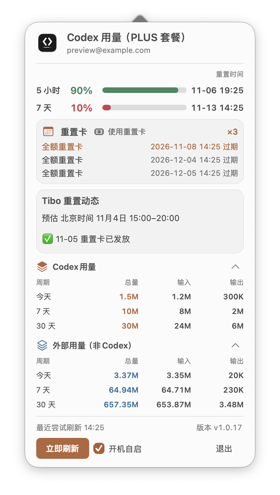

# CodexUsage

**Codex 还剩多少，什么时候恢复？在 Mac 菜单栏一眼看见。**

无需反复打开网页，随时查看额度、重置时间和用量。

[下载 CodexUsage](https://github.com/JUNX7764/Codexusage/releases/latest) · macOS 13+ · Apple Silicon

**本地统计会话用量，不上传会话记录。**

*截图使用演示数据。*

## 能做什么

- **随时看额度**：菜单栏显示 5 小时和 7 天剩余百分比，点开即可查看重置时间。
- **管理重置卡和动态**：查看重置卡数量和到期时间，确认后可使用最早到期的可用卡；结果未知时可确认后用原请求重试。查看近期额度重置动态，预告时间仅供参考。
- **回顾使用情况**：查看今天、近 7 天和近 30 天的 Token 用量，分别展示输入与输出；点击周期整行可展开各模型明细。
- **了解其他工具用量**：单独查看本机 Proma、Claude Code 和 Hermes 中可读取的 OpenAI 模型用量，与 Codex 用量分开展示。
- **方便日常使用**：支持立即刷新、开机自启和面板内更新进度。

额度来自当前登录账号；Token 用量根据本机可读取的会话记录统计，不代表其他设备的完整用量。

重置卡使用后可能消耗一张卡且无法撤销。用卡接口已通过模拟响应验证，尚未进行真实兑换测试。

## 安装

1. 在 [Releases](https://github.com/JUNX7764/Codexusage/releases/latest) 下载最新的 `CodexUsage.dmg`。
2. 打开安装包，将 CodexUsage 拖入“应用程序”，然后打开。
3. 使用前请先在本机 Codex CLI 登录 ChatGPT 账号。应用会读取已有登录状态来查询额度。

首次打开如遇“已损坏”或“无法验证开发者”提示：前往“系统设置 → 隐私与安全性”，点击底部“仍要打开”；或在终端执行 `xattr -d com.apple.quarantine /Applications/CodexUsage.app`。本应用使用 ad-hoc 签名，不影响功能。

## 更新

有新版本时，点击面板顶部的更新提示，应用会显示更新进度并自动重启。较早的旧版本升级到带有此功能的版本时，仍会打开一次终端窗口。

## 数据与隐私

**本机会话记录和用量统计在 Mac 上处理，不会上传到开发者服务器。**

查询额度和重置卡需要使用登录凭据连接 OpenAI；重置动态及版本检查分别连接 AIHOT 和 GitHub。登录状态过期时，应用可能续期并更新本机 Codex 凭据文件。

## 其他工具

同系列：[KimiUsage](https://github.com/JUNX7764/kimi-usage-menubar) · [GlmUsage](https://github.com/JUNX7764/Glmusage)

[开发说明](docs/DEVELOPMENT.md) · [MIT License](LICENSE)
