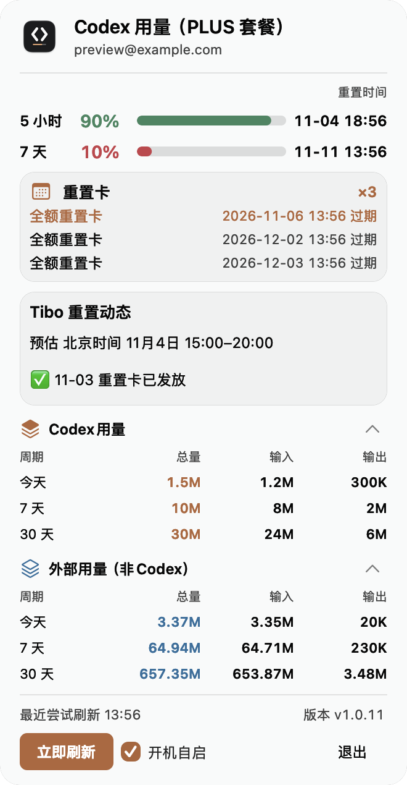
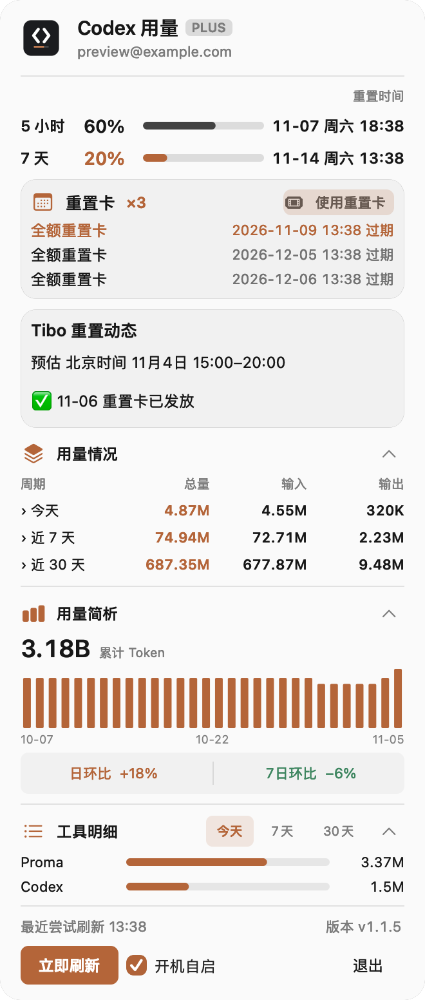

# CodexUsage

**Codex 额度与用量，在 Mac 菜单栏一眼看清。**

无需反复打开网页：查看剩余额度和重置时间，管理重置卡，也能回顾近期 Token 趋势与工具分布。

**[下载 CodexUsage](https://github.com/JUNX7764/Codexusage/releases/latest)** · macOS 13 或更高版本 · Apple Silicon 或 Intel 芯片

 

截图使用演示数据，展示当前版本界面。

## 能做什么

- **额度与重置时间**：菜单栏显示适用的额度窗口及剩余百分比，点开查看 5 小时、7 天额度和重置时间。
- **重置卡与动态**：查看重置卡数量和到期时间，确认后可使用最早到期的可用卡；同时查看近期额度重置动态，预告时间仅供参考。
- **本机周期用量**：查看今天、近 7 天和近 30 天的 OpenAI 模型 Token 总量、输入与输出，点击周期行展开模型明细。
- **官方用量简析**：展示账号接口返回的累计 Token 与止于今日的近 30 日用量，支持按日查看及日环比、7 日环比；官方日桶缺今日时以与「本机周期用量」相同的合并口径补足，缺失或比较数据不足时明确提示。
- **工具明细**：按周期查看本机 Codex、Proma、Claude Code、Hermes 中可识别的用量、占比和来源状态。
- **面板背景**：从页头切换纯色、经典毛玻璃或液态玻璃（macOS 26 及以上）；系统开启降低透明度时自动使用纯色。
- **省心常驻**：支持立即刷新、开机自启、面板内更新进度，以及异常或数据过期提示。

## 统计口径

账户标签依据额度接口返回的套餐名称显示；无法确认的 Pro 子档位显示为 Pro，API Key 登录单独标识，颜色不表示额度状态。

额度、重置卡和官方用量简析来自当前登录账号；本机周期用量与工具明细来自可读取的会话记录，可能包含不同账号或 API 调用。**两者统计范围不同，不会相加，也不代表所有设备的统一账单。**

官方日数据的时区与覆盖范围尚未确认；按官方客户端显示规则，在已返回的最早与最晚日期之间缺桶按零展示，范围外不外推。官方日桶尚未包含当日时，简析的今日柱与比较改用与「本机周期用量」相同的合并口径补足（描边空心柱），其余历史日桶保持账号口径。各工具的日志适配、订阅登录与官方汇总覆盖情况见[用量来源兼容矩阵](docs/project/14-compatibility-matrix.md)。

重置卡使用后可能消耗一张卡且无法撤销；结果未知时，可确认后用原请求重试。用卡接口已通过模拟响应验证，尚未进行真实兑换测试。

## 安装

1. 在本机 Codex CLI 登录 ChatGPT 账号；应用会读取已有登录状态来查询额度。
2. 在[下载页面](https://github.com/JUNX7764/Codexusage/releases/latest)下载最新的 `CodexUsage.dmg`。
3. 打开安装包，将 CodexUsage 拖入「应用程序」，然后打开。图标会出现在屏幕顶部菜单栏。

首次打开如遇「已损坏」或「无法验证开发者」提示：前往「系统设置 → 隐私与安全性」，点击底部「仍要打开」；或在终端执行 `xattr -d com.apple.quarantine /Applications/CodexUsage.app`。应用使用 ad-hoc 签名，不影响功能。

## 更新

有新版本时，点击面板顶部的更新提示可先查看版本说明；确认后才下载并安装，面板会显示进度，完成后自动重启。较早的旧版本升级到带有此功能的版本时，仍会打开一次终端窗口。

## 数据与隐私

**本机会话记录和用量统计在 Mac 上处理，不会上传到开发者服务器。**

查询额度、重置卡和官方用量简析需要使用登录凭据连接 OpenAI；重置动态及版本检查分别连接 AIHOT 和 GitHub。登录状态过期时，应用可能续期并更新本机 Codex 凭据文件。

## 其他工具

[KimiUsage](https://github.com/JUNX7764/kimi-usage-menubar) · [GlmUsage](https://github.com/JUNX7764/Glmusage)

[开发说明](docs/DEVELOPMENT.md) · [MIT License](LICENSE)
